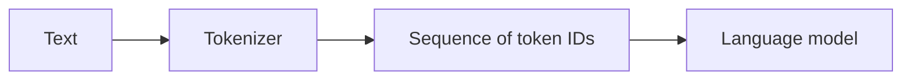
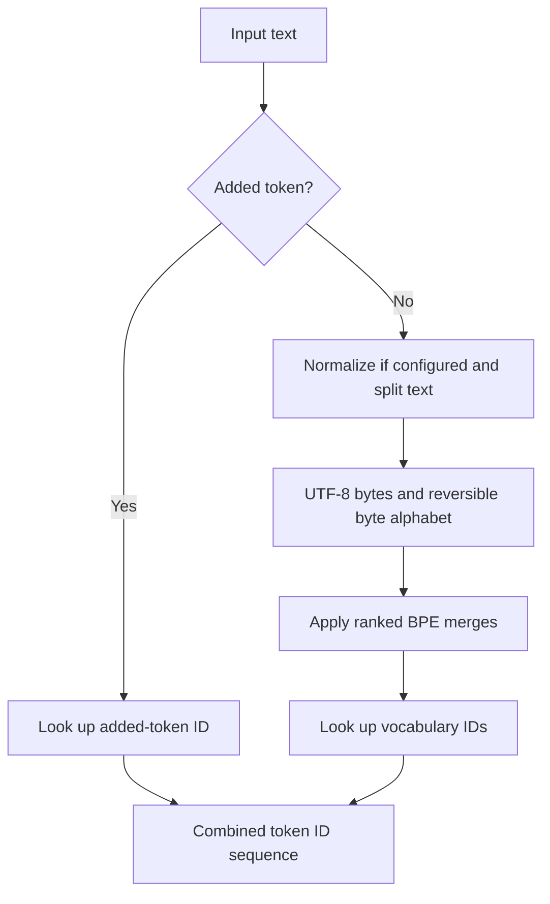
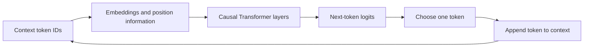
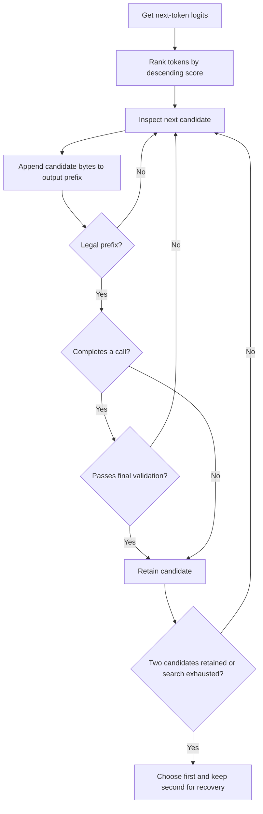
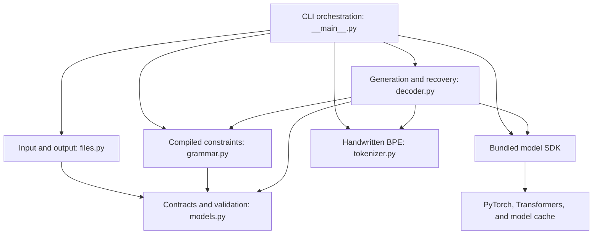
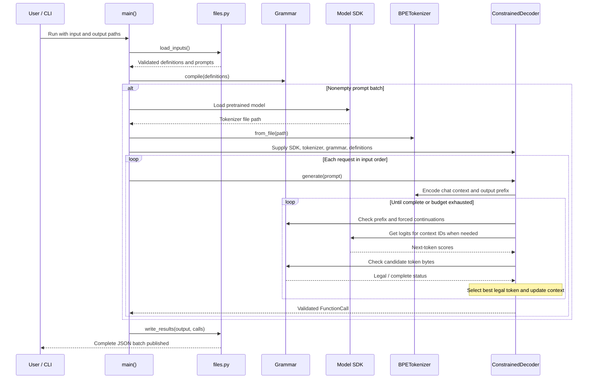
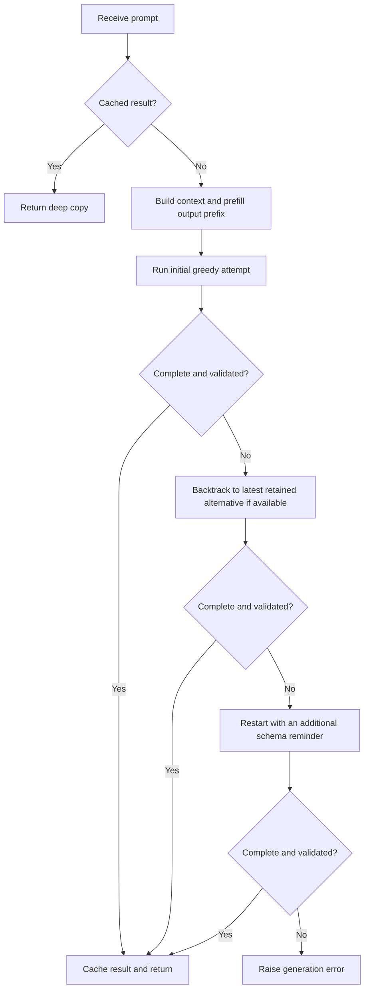

# Understanding Lexicall: from tokens to function calls

This guide builds from the foundations upward. Start with how a language model
receives text and predicts tokens, then see how Lexicall turns those predictions
into validated function calls. The diagrams and implementation details describe
the code currently in this repository.

## 1. What is Lexicall?

Lexicall translates a natural-language request into a structured description of
a function call:

```text
Input:  What is the sum of 2 and 3?
Output: {"name":"fn_add_numbers","parameters":{"a":2,"b":3}}
```

It selects a function and extracts arguments. It does not execute that function
or calculate the answer `5`. The saved record also includes the original prompt:

```json
{
  "prompt": "What is the sum of 2 and 3?",
  "name": "fn_add_numbers",
  "parameters": {"a": 2, "b": 3}
}
```

The function names and argument schemas come from an input file. They are not
implemented Python functions that Lexicall invokes.

## 2. Foundation: text, bytes, tokens, and token IDs

A language model does not receive a Python string directly. A **tokenizer**
converts text into a sequence of integer **token IDs** from a fixed vocabulary.

A token can represent a word, part of a word, punctuation, whitespace, or bytes
that form only part of a Unicode character. Tokens are not necessarily words.



For illustration only, a tokenizer could split `Hello world` into `Hello` and
` world`, each with its own ID. Actual splits and IDs depend on the vocabulary.
The leading space matters: it can be part of the token.

### Byte-level BPE in this project

Our tokenizer is implemented in `src/tokenizer.py`, in `BPETokenizer`.
**BPE** means byte-pair encoding. Its vocabulary and merge priorities were
already learned when the model's tokenizer was built; our application loads
those rules and applies them. It does not train a tokenizer.

Encoding follows these steps:

1. Recognize added tokens, including special chat markers, before ordinary text.
2. Apply NFC Unicode normalization if the tokenizer configuration declares it.
3. Split ordinary text using the tokenizer's pre-tokenization regular expression.
4. Encode each piece as UTF-8 bytes and map the bytes to a reversible alphabet.
5. Repeatedly merge adjacent symbols using the lowest-ranked available BPE rule.
6. Look up the final symbols in the vocabulary to obtain token IDs.



Decoding reverses the mappings, joins the bytes, and then decodes UTF-8. Joining
bytes first matters because an individual token may contain an incomplete
character. `decode()` can omit special tokens.

`BPETokenizer.from_file()` loads the model's `tokenizer.json` through a public
SDK method. The tokenizer must match the model: a particular ID has meaning only
relative to the vocabulary that model was trained with.

## 3. Foundation: how a model reads and produces tokens

Inside a typical causal Transformer language model, token IDs select learned
vectors called **embeddings**. Transformer layers use attention and other
learned operations to combine information from the preceding context. Position
information lets the model account for token order.

The final model output contains one score per vocabulary token for the next
position. These raw scores are called **logits**. They are not token IDs or
probabilities. Softmax can convert logits to probabilities, but Lexicall can
rank candidates directly by their logits without computing softmax.



This repeated process is **autoregressive generation**: each new prediction
depends on the context plus previously generated tokens. The model is not
writing the entire answer in one operation.

In this repository, the model internals belong to the bundled SDK and its
dependencies. `Small_LLM_Model.get_logits_from_input_ids(ids)`:

1. Converts the IDs to a PyTorch tensor on the model's device.
2. Runs the pretrained causal language model without gradient calculation.
3. Takes the final position's logits.
4. Returns them as a Python list of floating-point scores.

The application supplies the token-selection algorithm. Model weights stay
fixed: this is **inference**, not model training or fine-tuning.

### What is the context?

The model receives more than the user's sentence. `chat_prompt()` builds text
containing system instructions, a serialized function catalog, the user request,
and an assistant prefix. Chat markers delimit the roles. The Qwen3 profile also
adds a closed empty thinking block to request non-thinking output.

These instructions help the model make a useful choice, but instructions alone
do not enforce JSON validity. That requires the next layer.

## 4. Foundation: schemas and constrained generation

A **schema** describes the allowed shape and types of data. For example, addition
requires parameters named `a` and `b`, both numeric. `src/models.py` represents
these contracts using Pydantic models and explicit recursive validation.

The supported schema subset includes strings, numbers, integers, booleans,
nulls, objects, arrays, descriptions, and enums. Top-level arguments are required.
Nested objects can declare optional properties through a `required` list.
Unknown properties and unsupported schema keywords are rejected.

`src/grammar.py` compiles the function catalog into a byte-oriented regular
expression. Each branch binds a particular function name to its parameter
schema. Generated objects use definition order and omit formatting whitespace,
reducing choices that do not affect meaning.

### Legal prefix versus completed call

The grammar can check incomplete output using partial matching:

| Example text | Meaning |
|---|---|
| `{"name":"fn_add` | Potentially legal prefix, assuming a matching function exists |
| `{"name":"fn_add_numbers","parameters":{"a":2,"b":3}}` | Complete legal call for the supplied addition definition |
| `{"name":"unknown_function"` | Illegal for the supplied catalog |
| `{"name":"fn_add_numbers","parameters":{"a":true` | Illegal: this parameter requires a number |

`Grammar.state(prefix)` returns `(legal, complete)`. A legal prefix can still be
extended into a matching call; a complete call already matches the whole grammar.
Checks operate on bytes so incomplete UTF-8 sequences can be handled correctly.

### How Lexicall chooses the next token

`ConstrainedDecoder.candidates()` reads model logits in descending score order.
For each candidate it appends the candidate's entire byte sequence to the output
prefix and asks the grammar whether that prefix is legal.



The first retained candidate is the highest-scoring legal token: **greedy
constrained decoding**. The second is a fallback for backtracking. If no legal
candidate with a finite score exists, the attempt fails.

The implementation rejects invalid logits, skips unusable tokens, and masks
illegal candidates with negative infinity. It stops once the best two legal
candidates are known rather than checking the whole vocabulary every time.

Checking the whole token is essential: one token may contain several JSON
delimiters, so checking its first character would be insufficient.

### Forced syntax and a narrower extraction context

Generation starts with a prefilled `{"name":"` prefix. The model chooses the
function-name content, preserving its generated tokenization.

After the function name is complete:

- `Grammar.forced_suffix()` inserts bytes when exactly one legal continuation
  exists. Fixed keys and delimiters often need no model prediction.
- The chat context is rebuilt with only the selected function's definition.
  This reduces the context used when extracting arguments.
- When text is inserted or context changes, the combined text is retokenized
  so BPE boundaries remain consistent.

The grammar still represents the original catalog. Context narrowing does not
change that catalog or execute the selected function.

## 5. Architecture: who owns each responsibility?



| File | Main responsibility | Start reading at |
|---|---|---|
| `src/__main__.py` | Parse CLI options and connect the components | `main()` |
| `src/files.py` | Load strict JSON, validate input collections, publish results atomically | `load_inputs()`, `write_results()` |
| `src/models.py` | Define data contracts and recursively validate arguments | `FunctionDefinition`, `FunctionCall`, `validate_call()` |
| `src/tokenizer.py` | Convert text to model-compatible IDs and IDs to text | `encode()`, then `encode_piece()` |
| `src/grammar.py` | Compile schemas and check output prefixes | `compile()`, `state()` |
| `src/decoder.py` | Build prompts, select tokens, recover, and cache calls | `chat_prompt()`, `candidates()`, `generate()` |
| `llm_sdk/llm_sdk/__init__.py` | Load the model and expose inference and tokenizer-file access | `Small_LLM_Model`, `get_logits_from_input_ids()` |

### Why there are classes and functions

The tokenizer, grammar, and decoder are objects because their operations share
state: vocabulary, compiled constraints, caches, dependencies, and configuration.
Pydantic classes also describe validated data such as `Prompt` and `Schema`.
Standalone functions handle operations such as reading JSON or validating a value.

The decoder receives its dependencies rather than loading the model itself.
This is dependency injection: the CLI assembles the components, while the decoder
uses the supplied SDK, tokenizer, and grammar. The current SDK field is typed as
`Any`; the required inference method is therefore implicit rather than expressed
through a typed interface.

## 6. Repository layout and external resources

```text
Lexicall/
├── src/                                # application code
├── data/
│   ├── input/
│   │   ├── functions_definition.json
│   │   └── function_calling_tests.json
│   └── output/                         # generated; ignored by Git
│       └── function_calling_results.json
├── llm_sdk/                            # local SDK project
│   ├── pyproject.toml                  # inference dependencies
│   └── llm_sdk/                        # importable Python package
│       └── __init__.py
├── pyproject.toml                      # application and development dependencies
├── uv.lock                             # resolved dependency versions
├── Makefile
├── README.md
└── ARCHITECTURE.md
```

- `functions_definition.json` supplies five function descriptions and schemas.
  The `returns` fields describe return types; the application does not generate
  or validate actual function return values because it never executes the calls.
- `function_calling_tests.json` contains eleven example requests. It has no
  expected answers or automated assertions; it is the default batch input.
- `uv sync` installs the bundled SDK using the local path source declared in the
  root `pyproject.toml`. Its own packaging file declares inference dependencies.
  The default development group installs lint, type-check, and formatting tools.
  `make install` runs `uv sync --locked` against the committed `uv.lock`.
- Model weights and tokenizer files are downloaded through Hugging Face and
  reused from its cache. They are not bundled in the repository.

## 7. End-to-end implementation flow

Running `make run` executes `uv run python -m src`, which uses the project's
managed environment. The evaluator can run `uv sync` followed by
`uv run python -m src` directly. `make debug` starts the same module through
Python's `pdb` debugger. All commands should be run from the repository root.



In concrete steps:

1. Parse paths, model profile, device, tracing option, and token budget.
2. Read both input files. Reject duplicate JSON keys, invalid constants,
   malformed records, an empty function catalog, and duplicate function names.
3. Reject an output path that resolves to either input file.
4. Compile the function catalog into a grammar.
5. For a nonempty prompt batch, set default CPU-thread configuration, load the
   SDK model, load our tokenizer, and construct the decoder. An empty prompt
   batch skips model loading and produces `[]`.
6. Generate and validate one call per request, keeping input order and duplicates.
7. Write all results only after the whole batch succeeds.

The original prompt is attached by application code after parsing the generated
call. The model generates the `name` and `parameters` object, not the saved
`prompt` field.

## 8. What happens inside generate()?



Within an attempt, the decoder checks for forced continuations, adjusts context,
checks completion and budget, obtains legal candidates, records a `Decision`,
and appends the selected token. Each decision retains enough information to
resume from an alternative: output prefix, context, token IDs, and fallback ID.

Recovery is bounded to three attempts: initial generation, one backtrack, and
one fresh generation with a reminder. It is not an exhaustive search. A valid
but semantically wrong call does not trigger recovery because the program has
no reference answer against which to compare it.

## 9. Validation, reliability, and performance

### Three different meanings of correctness

| Level | Question | Mechanism |
|---|---|---|
| JSON syntax | Can this text be parsed as JSON? | Grammar and JSON parsing |
| Schema validity | Is the name known, and are the arguments allowed and correctly typed? | Grammar, Pydantic, and recursive validation |
| Semantic accuracy | Does this call express what the user intended? | Model behavior; measured using examples with expected answers |

For `Add 2 and 3`, a call with `a: 2` and `b: 4` can pass structural validation
while being semantically wrong. Constraints enforce the supported structure;
they do not establish that the model understood the request.

Final validation rejects missing or extra arguments, invalid types, non-finite
numbers, and invalid strings. Booleans are distinguished from integers, and
numeric strings are not silently converted to numbers.

### Safe publication and errors

`write_results()` serializes to a temporary file beside the destination, flushes
and synchronizes it, then uses `os.replace()` to publish the complete batch.
A generation failure does not replace an existing result file. Temporary output
is cleaned up if publication fails.

Diagnostics and optional generation traces go to stderr; the result file contains
JSON only. The CLI returns `0` for success, `1` for a handled failure, `2` for
invalid CLI arguments, and `130` for interruption.

### Where time is saved

- The tokenizer caches BPE results for repeated text pieces.
- The grammar caches prefix checks. Its cache is cleared at a size threshold;
  it does not implement least-recently-used eviction.
- The decoder caches completed requests and returns deep copies for duplicates.
  This cache belongs to one decoder instance and is not persisted across runs.
- Forced continuations avoid inference for bytes with only one legal continuation.
- Function-specific extraction contexts reduce the input length after selection.
- Candidate checking stops after the top two legal tokens are found.

The SDK recomputes the full supplied context for each prediction; it exposes no
public reusable attention key/value cache. This is a major inference cost.
`--visualize` adds work by counting legal tokens through a vocabulary byte trie,
so trace-enabled timings should not be treated as ordinary performance timings.

## 10. Suggested learning path

The explanation above starts at the foundations. When reading the implementation,
use a different order so you see the whole application before its hardest parts:

1. Read the two input JSON files. Predict the expected call for one addition prompt.
2. Read `main()` in `src/__main__.py`. Identify the inputs and outputs of each step.
3. Read `Prompt`, `FunctionDefinition`, and `FunctionCall` in `src/models.py`.
4. Read `load_inputs()` and `write_results()` in `src/files.py`.
5. Read `chat_prompt()` and `candidates()` in `src/decoder.py`.
6. Follow `generate()` using the same addition example.
7. Study `Grammar.state()` and schema compilation in `src/grammar.py`.
8. Study BPE encoding and decoding in `src/tokenizer.py`.

For each function, write down its input, output, and purpose. You understand the
core architecture when you can explain this chain in your own words:

**Request and catalog → chat context → token IDs → model logits → grammar-filtered
token choices → completed call → validation → saved JSON.**
